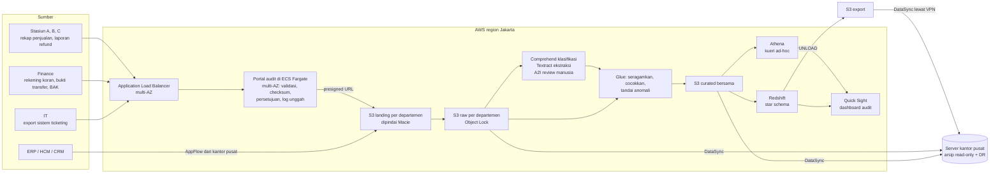

# Arsitektur platform data audit

Dokumen ini menjelaskan alur data dari departemen sumber sampai dashboard audit, pembagian peran antara AWS region Jakarta (`ap-southeast-3`), tempat semua komponen aktif berjalan, dan server on-premise kantor pusat yang hanya menerima salinan data, serta pertimbangan ketersediaan dan pengelolaan infrastruktur. Diagram visual ada di `docs/img/` (spesifikasi di `diagrams/`).

## Prinsip

1. **AWS sebagai sumber kebenaran tunggal.** Semua komponen aktif, termasuk portal unggah, berjalan di AWS, dan semua transformasi serta pencocokan terjadi di satu tempat. Server kantor pusat hanya menerima salinan hasil untuk arsip dan pemulihan bencana, sehingga tidak ada dua versi kebenaran dan lineage tidak bercabang.
2. **Satu pintu masuk untuk data manual.** Stasiun, finance, dan IT mengunggah data hanya lewat portal audit terpusat. Integrasi sistem ke sistem (ERP, HCM, CRM) tidak lewat portal.
3. **Kepatuhan dulu, lalu ketersediaan, lalu biaya.** Opsi yang tidak memenuhi aturan lokasi data dan perlindungan data pribadi gugur sebelum dibandingkan dari sisi lain.
4. **Netral alat di lapisan logika.** Model data, pemetaan sumber ke target, dan aturan audit ditulis sebagai dokumen dan SQL standar. Layanan AWS adalah satu implementasi, bukan satu-satunya.

## Alur data

### 1. Ingest

| Sumber | Jalur | Frekuensi | Catatan |
|---|---|---|---|
| Rekap penjualan stasiun | Portal | Bulanan, tenggat tanggal 5 | Template baku per stasiun; selama masa transisi tiga layout lama masih diterima dan diseragamkan di Glue |
| Laporan refund (scan) | Portal | Bulanan | File PDF atau gambar, diproses di tahap dokumen |
| Rekening koran, bukti transfer, BAK | Portal | Bulanan | Bukti transfer dan BAK berupa scan, rekening koran berupa CSV atau PDF dari bank |
| Export sistem ticketing | Portal | Bulanan (bisa harian) | System of record penjualan; IT mengunggah export, bukan memberi akses langsung ke database produksi |
| ERP, HCM (pegawai, shift), CRM | Amazon AppFlow | Terjadwal | Sistem ke sistem; detail konektor dibahas di dokumen integrasi ERP terpisah |

Portal adalah aplikasi web khusus audit dan data engineering yang berjalan penuh di AWS. Aplikasinya berupa container di Amazon ECS Fargate yang tersebar di dua AZ, di belakang Application Load Balancer multi-AZ. Tiap departemen (stasiun, finance, IT) punya halaman portal dan bucket landing sendiri. Server kantor pusat tidak menjalankan portal.

Alur satu unggahan:

1. Pengguna memilih periode dan jenis data. Browser memeriksa template dari isi file (nama kolom, kolom wajib, format tanggal, tipe angka) dan menghitung checksum SHA-256.
2. Portal mencatat unggahan baru di log, lalu menerbitkan presigned URL berumur pendek yang hanya berlaku untuk satu object key di bucket landing departemen pengguna, lengkap dengan checksum yang diharapkan (`x-amz-checksum-sha256`). S3 menolak objek yang isinya tidak sesuai checksum.
3. File diunggah langsung dari browser ke S3, tidak melewati container portal. Ukuran file besar tidak membebani aplikasi.
4. Event S3 memicu validasi ulang di sisi server. File yang gagal tetap di landing dengan status `FAILED` dan tidak pernah dipromosikan ke raw.
5. Data owner departemen menyetujui unggahan di portal. Pengunggah, departemen, periode, waktu, tenggat, nomor revisi, checksum, dan persetujuan tercatat di log unggah.

Log unggah ini menjadi sumber indikator kepatuhan unggah per departemen (lihat `tata-kelola.md`).

### 2. Landing, pemindaian, dan raw

- Bucket landing dipisah per departemen (`stasiun`, `finance`, `it`, `erp`), masing-masing dengan kunci KMS sendiri. Pemisahan ini memudahkan pengelolaan akses: hak baca data finance bisa dicabut tanpa menyentuh data stasiun.
- Amazon Macie memindai bucket landing untuk menemukan data pribadi (NIK, nomor paspor, nomor rekening). Macie hanya bisa membaca objek yang sudah ada di S3, karena itu landing berfungsi sebagai zona karantina.
- Objek yang lolos dipromosikan ke prefix `raw/` yang dilindungi S3 Object Lock mode compliance dengan masa retensi sesuai kebijakan retensi audit. Selama masa retensi objek tidak bisa dihapus atau ditimpa oleh siapa pun, termasuk akun root.
- S3 Versioning aktif di semua bucket; CloudTrail data events mencatat setiap `PutObject`, `GetObject`, dan `DeleteObject`.

### 3. Digitalisasi dokumen scan

Laporan refund, bukti transfer, dan BAK sering berupa kertas yang discan, kadang tulisan tangan, kadang tidak berurutan.

1. Amazon Comprehend custom classification memilah jenis dokumen (laporan refund, bukti transfer, BAK, lain-lain).
2. Amazon Textract dengan Custom Queries adapter mengekstrak isian (nomor tiket, nominal, tanggal, nama penerima, nomor referensi). Textract tidak bisa di-fine-tune; adapter adalah cara resmi untuk menyesuaikan ke format dokumen sendiri.
3. Hasil dengan confidence rendah, teks tertimpa, atau kolom kosong masuk Amazon A2I. Pola maker-checker: staf IT mengisi atau mengoreksi (maker), staf stasiun atau finance yang memahami dokumen mengafirmasi (checker). Identitas dan waktu keduanya tercatat di data (`a2i_maker`, `a2i_checker`).

Review manusia di tahap ini penting karena kesalahan OCR bisa menjadi temuan palsu, misalnya nominal refund yang terbaca salah.

### 4. Transformasi dan pencocokan

AWS Glue menjalankan seluruh transformasi. Dari on-premise cukup extract dan upload. Tahapannya mengikuti `source-to-target.md`:

1. Seragamkan skema tiap sumber (tiga layout rekap stasiun menjadi satu tabel, format tanggal dan nominal, kode periode).
2. Deduplikasi dan pemeriksaan kualitas data.
3. Turunkan kunci pencocokan dari teks bebas (nomor referensi dan nama dari keterangan rekening koran).
4. Pseudonimkan identitas pembeli (hash NIK atau paspor dengan salt) untuk lapisan analitik.
5. Jalankan aturan audit dan kepatuhan unggah (`aturan-audit.md`), tulis hasilnya ke tabel exception.

Hasil masuk ke satu bucket curated bersama. Curated tidak dipecah per departemen karena isinya adalah hasil integrasi lintas departemen. Glue Data Catalog menjadi katalog metadata teknis untuk Athena dan Redshift Spectrum.

### 5. Analitik

- **Athena** untuk kueri ad-hoc auditor langsung ke curated, misalnya menelusuri satu order lintas sumber.
- **Redshift** untuk star schema (`model-data.md`) dan kueri berulang dashboard. Athena dan Redshift berjalan paralel dari curated yang sama, bukan berurutan.
- **Quick Sight** untuk dashboard audit: daftar exception per aturan dan stasiun, tren, indikator kepatuhan unggah per departemen.

RDS tidak dipakai di jalur pipeline. Basis data relasional hanya untuk aplikasi portal sendiri (lihat opsi di bawah).

### 6. Arsip dan pemulihan di kantor pusat

Redshift `UNLOAD` menulis hasil final (fakta, dimensi, exception) ke bucket export dalam format Parquet. AWS DataSync menyalin isi bucket export, prefix `raw/`, dan bucket curated ke server kantor pusat lewat Site-to-Site VPN. Server kantor pusat:

- menyimpan arsip read-only data mentah, data final, dan exception;
- menjadi pemulihan bencana dalam negeri bila region Jakarta terganggu, karena region AWS terdekat berikutnya ada di luar Indonesia dan bertentangan dengan aturan lokasi data.

## Ketersediaan

| Komponen | Cara | Catatan |
|---|---|---|
| S3, Glue, Athena, Comprehend, Textract, A2I, AppFlow, Quick Sight | Layanan regional, otomatis tersebar di beberapa AZ | Tidak perlu konfigurasi Multi-AZ |
| Redshift | Redshift Multi-AZ (RA3) | Dua AZ, failover otomatis |
| Koneksi kantor pusat ke AWS | Site-to-Site VPN dua tunnel | Satu tunnel putus, tunnel lain tetap jalan |
| Portal | Application Load Balancer multi-AZ di depan ECS Fargate multi-AZ | Satu AZ terganggu, task di AZ lain tetap melayani; file langsung ke S3 lewat presigned URL |
| Server kantor pusat | Hanya penerima salinan | Gangguan di kantor pusat tidak menghentikan unggahan maupun pipeline; yang tertunda hanya penyalinan arsip |
| Gangguan seluruh region | Server kantor pusat sebagai DR | Cross-region ke luar negeri tidak dipakai |

Satu-satunya komponen yang perlu dibagi bebannya adalah portal, karena itu Application Load Balancer hanya dipakai di depan portal. Komponen lain adalah layanan terkelola.

### Opsi portal yang belum diputuskan

| Aspek | Opsi | Catatan |
|---|---|---|
| Akses jaringan | ALB internal yang hanya bisa diakses dari jaringan perusahaan lewat Site-to-Site VPN | Permukaan serangan paling kecil; stasiun harus terhubung ke jaringan perusahaan |
| | ALB publik dengan AWS WAF | Bisa diakses dari mana saja; butuh aturan WAF dan pembatasan IP atau login yang kuat |
| Login | IAM Identity Center atau Amazon Cognito, terhubung ke direktori perusahaan (SSO) | Akun portal ikut nonaktif saat pegawai keluar |
| Metadata dan log unggah | Amazon RDS Multi-AZ | Log unggah, pengguna, alur persetujuan; aktivitas basis data dicatat dengan Database Activity Streams |

## Keamanan dan kepatuhan (ringkas)

Rincian ada di `tata-kelola.md`.

- Enkripsi: SSE-KMS dengan kunci per bucket departemen; TLS untuk semua transfer.
- Akses: Lake Formation untuk izin tingkat database, tabel, kolom, dan baris per departemen; kolom identitas mentah hanya terbuka untuk peran tertentu.
- Jejak: CloudTrail (termasuk data events S3), Redshift audit logging, access log ALB, log aplikasi portal.
- Integritas: checksum saat unggah, Object Lock di `raw/`, Versioning, pemeriksaan ulang checksum objek terhadap log unggah.
- Bukti kontrol: AWS Audit Manager mengumpulkan bukti per periode audit; AWS Artifact menyediakan laporan kepatuhan AWS sendiri sebagai lampiran pengajuan rencana infrastruktur.

## Infrastructure as code

Infrastruktur AWS dibangun dengan AWS CDK, yang di-synthesize menjadi template CloudFormation lalu di-deploy sebagai stack.

- Bahasa CDK mengikuti tim IT perusahaan (TypeScript, Python, Java, C#, atau Go). Usulan default Python agar sejalan dengan skrip Glue PySpark.
- Setiap perubahan lewat change set CloudFormation yang ditinjau sebelum dieksekusi. Riwayat stack menjadi jejak audit perubahan infrastruktur.
- Drift detection dijalankan terjadwal untuk menangkap perubahan manual di konsol.
- Bila lingkungan rusak dan tidak bisa dipulihkan, pipeline bisa dibangun ulang dari kode.

Kode CDK belum ada di repo ini. Pembagian stack yang diusulkan: `network` (VPN), `storage` (bucket, KMS, Object Lock), `portal` (ALB, ECS Fargate, basis data portal), `ingest` (AppFlow, presigned URL dan peran per departemen), `document` (Comprehend, Textract, A2I), `processing` (Glue), `analytics` (Redshift, Athena, Quick Sight), `governance` (Lake Formation, Macie, CloudTrail, Audit Manager).

## Pengujian lokal

Logika transformasi dan aturan audit bisa diuji tanpa AWS: `data-dummy/generate.py` membuat semua sumber dengan anomali terkontrol, dan `etl/run_pipeline.py` menjalankan SQL di `sql/` dengan DuckDB.
