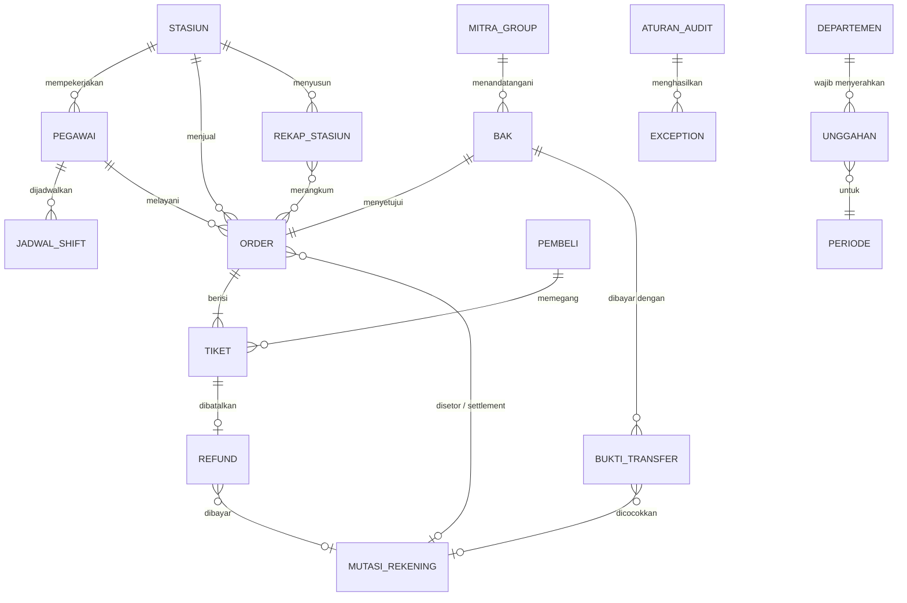
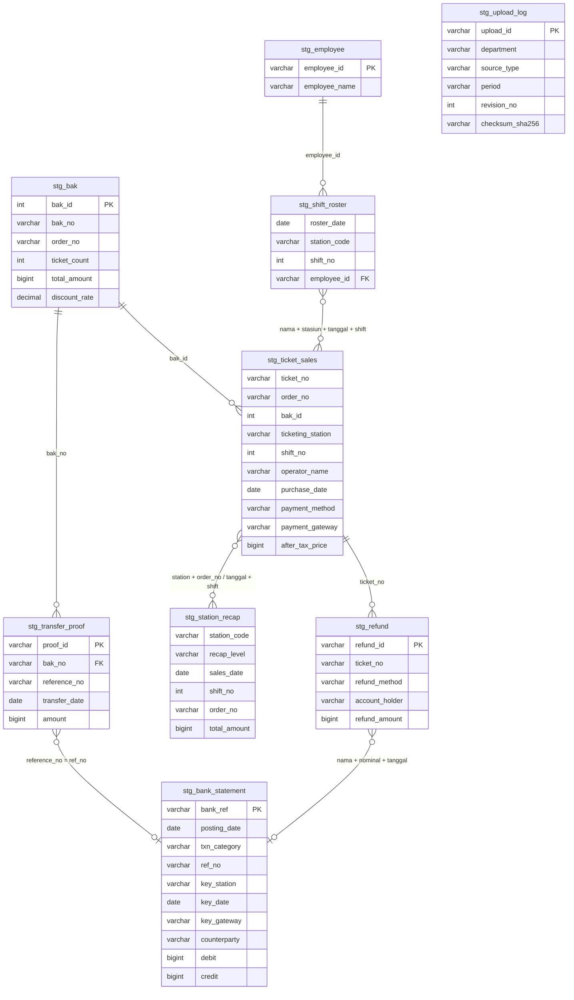

# Model data

Model ditulis dalam tiga lapis: konseptual (entitas bisnis), logis staging (satu tabel per sumber), dan dimensional (star schema untuk analitik). Semua netral alat; DDL fisik ada di `sql/01_staging_ddl.sql` dan `sql/05_dw_ddl.sql`.

## 1. Model konseptual

Entitas bisnis yang terlibat dalam audit penjualan group order dan refund, tanpa detail teknis.

Glosarium singkat:

| Entitas | Arti |
|---|---|
| Order | Satu transaksi pembelian; bisa berisi satu atau banyak tiket. Group order adalah order B2B dengan banyak tiket dan diskon |
| Tiket | Hak satu penumpang untuk satu perjalanan; unit terkecil di export ticketing |
| BAK | Berita acara kesepakatan group order: pihak kedua, jumlah tiket, nilai, diskon yang disetujui |
| Bukti transfer | Dokumen dari pembeli group order yang menyatakan pembayaran sudah dikirim |
| Mutasi rekening | Satu baris rekening koran perusahaan: transfer masuk, setoran tunai stasiun, settlement gateway, transfer keluar untuk refund |
| Rekap stasiun | Laporan penjualan buatan stasiun, turunan manual dari sistem ticketing |
| Refund | Pengembalian dana atas tiket yang dibatalkan, tunai atau transfer |
| Unggahan | Satu revisi file yang diserahkan departemen lewat portal untuk satu periode |
| Exception | Hasil satu aturan audit untuk satu entitas |

Masalah utama yang terlihat di model ini: hubungan ke MUTASI_REKENING bertanda `o|` karena rekening koran tidak menyimpan nomor order. Kunci pencocokan harus diturunkan dari keterangan transaksi, nominal, dan tanggal.

## 2. Model logis staging

Satu tabel per sumber, setelah tipe dan format diseragamkan. Kunci yang dipakai untuk mencocokkan antar sumber:

Rantai pencocokan:

| Pasangan | Kunci | Aturan |
|---|---|---|
| Export ↔ rekap stasiun | Stasiun + `order_no` (layout per order) atau stasiun + tanggal + shift (layout agregat) | R10 |
| Export ↔ BAK | `bak_id` | R04, R05, R06 |
| BAK ↔ bukti transfer | `bak_no` | - |
| Bukti transfer ↔ rekening koran | Nomor referensi, cadangan nominal + jendela tanggal | R01, R02, R03 |
| Export ↔ rekening koran | Stasiun + tanggal (setoran tunai), gateway + tanggal (settlement) | R03 |
| Refund ↔ export | `ticket_no` | R12, R13 |
| Refund ↔ rekening koran | Nama pemilik rekening + nominal + jendela tanggal | R14 |
| Export ↔ HCM | Nama operator + stasiun + tanggal + shift | R07 |
| Log unggah ↔ kewajiban ↔ storage | Departemen + sumber + stasiun + periode; nama file + checksum | U01-U06 |

## 3. Model dimensional

Star schema dengan lima fakta yang berbagi dimensi.

```mermaid
erDiagram
    dim_date ||--o{ fact_ticket_sale : "purchase_date_key, departure_date_key"
    dim_station ||--o{ fact_ticket_sale : "sales, origin, destination"
    dim_channel ||--o{ fact_ticket_sale : "channel_key"
    dim_payment_method ||--o{ fact_ticket_sale : "payment_key"
    dim_discount ||--o{ fact_ticket_sale : "discount_key"
    dim_employee ||--o{ fact_ticket_sale : "operator_key"
    dim_customer ||--o{ fact_ticket_sale : "customer_key"
    dim_group_order ||--o{ fact_ticket_sale : "group_order_key"
    dim_date ||--o{ fact_bank_mutation : "posting_date_key"
    dim_date ||--o{ fact_refund : "refund_date_key"
    dim_station ||--o{ fact_refund : "station_key"
    dim_customer ||--o{ fact_refund : "customer_key"
    dim_audit_rule ||--o{ fact_audit_exception : "rule_key"
    dim_source_dept ||--o{ fact_audit_exception : "dept_key"
    dim_source_dept ||--o{ fact_upload_submission : "dept_key"

    fact_ticket_sale {
        varchar ticket_no PK
        varchar order_no
        int shift_no
        bigint original_price
        bigint discount_amount
        bigint before_tax_amount
        bigint tax_amount
        bigint after_tax_amount
    }
    fact_bank_mutation {
        varchar bank_ref PK
        varchar txn_category
        bigint debit_amount
        bigint credit_amount
    }
    fact_refund {
        varchar refund_id PK
        varchar ticket_no
        varchar refund_method
        bigint ticket_price
        bigint refund_amount
    }
    fact_audit_exception {
        int rule_key PK
        varchar entity_id PK
        varchar entity_type
        varchar period
        int exception_count
    }
    fact_upload_submission {
        int dept_key PK
        varchar source_type PK
        varchar station_code PK
        varchar period PK
        int revisions
        int is_on_time
        int is_approved
        int is_checksum_ok
    }
```

### Grain dan ukuran

| Fakta | Grain | Ukuran | Contoh pertanyaan |
|---|---|---|---|
| `fact_ticket_sale` | Satu tiket (setelah deduplikasi) | Harga asli, nilai diskon, sebelum pajak, pajak, setelah pajak | Nilai diskon group per stasiun per bulan; penjualan per kanal |
| `fact_bank_mutation` | Satu baris rekening koran | Debit, kredit | Total setoran tunai vs penjualan tunai per hari |
| `fact_refund` | Satu refund | Harga tiket, nilai refund | Refund tunai per stasiun; proporsi refund WNA |
| `fact_audit_exception` | Satu exception (aturan × entitas) | Jumlah exception | Exception per aturan, stasiun, periode |
| `fact_upload_submission` | Satu kewajiban unggah per periode (periodic snapshot) | Revisi, flag tepat waktu, valid, disetujui, checksum cocok | Persentase tepat waktu per departemen |

### Dimensi

| Dimensi | Kunci natural | Atribut | Catatan |
|---|---|---|---|
| `dim_date` | Tanggal | Tahun, kuartal, bulan, hari, periode | Role-playing: tanggal beli, berangkat, posting, refund |
| `dim_station` | Kode stasiun | Nama, business area, fisik/online | Role-playing: stasiun penjualan, asal, tujuan |
| `dim_employee` | ID pegawai | Nama, departemen, stasiun, jabatan | SCD tipe 1; bisa naik ke tipe 2 bila mutasi pegawai perlu ditelusuri |
| `dim_channel` | Kode kanal | Kelompok kanal | |
| `dim_payment_method` | Metode + gateway | Tunai atau bukan | |
| `dim_discount` | Tipe + persentase | | |
| `dim_customer` | Hash identitas | Kewarganegaraan, asing atau bukan | Tanpa nama dan NIK (pseudonim) |
| `dim_group_order` | ID BAK | Nomor BAK, order, pihak kedua, diskon, jumlah tiket, nilai yang disetujui | |
| `dim_source_dept` | Nama departemen | | |
| `dim_audit_rule` | Kode aturan | Nama, kategori, tingkat risiko | Dari `ref_audit_rule` |

`ticket_no` dan `order_no` disimpan di fakta sebagai degenerate dimension agar auditor bisa menelusuri satu transaksi tanpa tabel dimensi tambahan.
